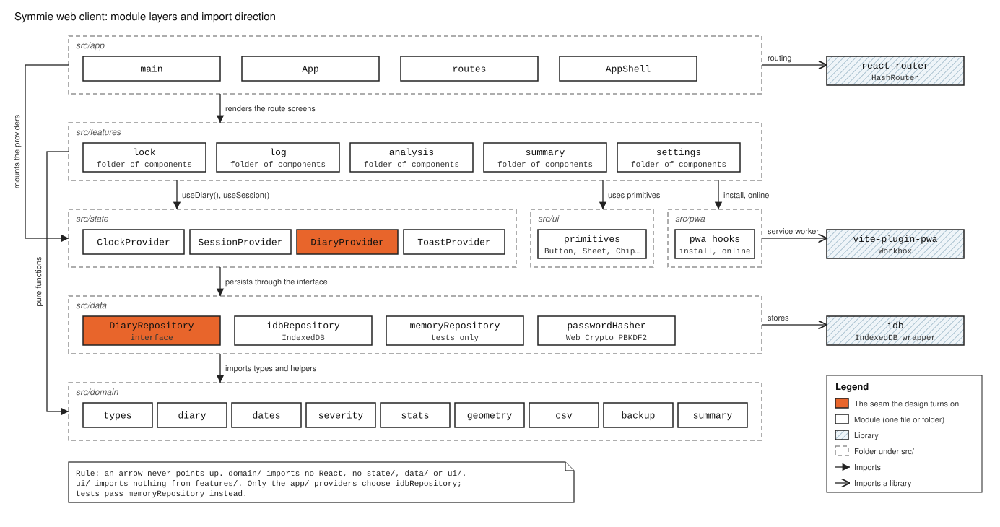
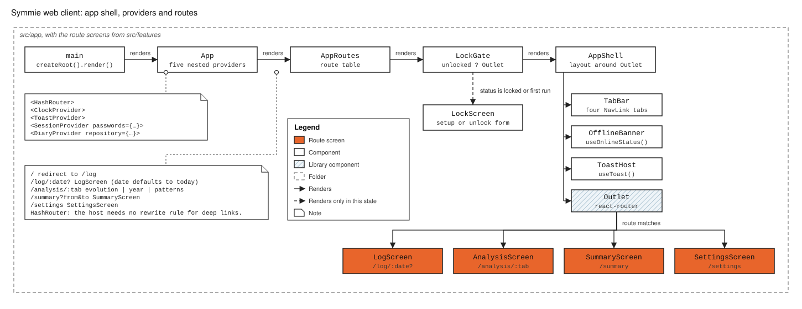
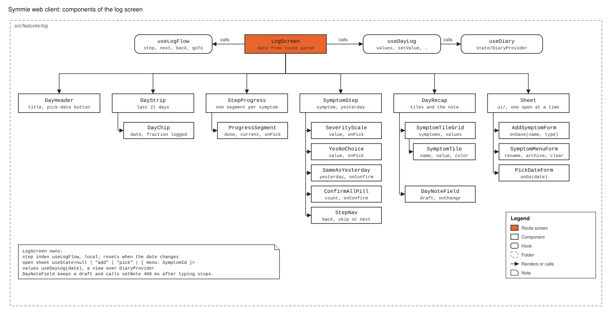
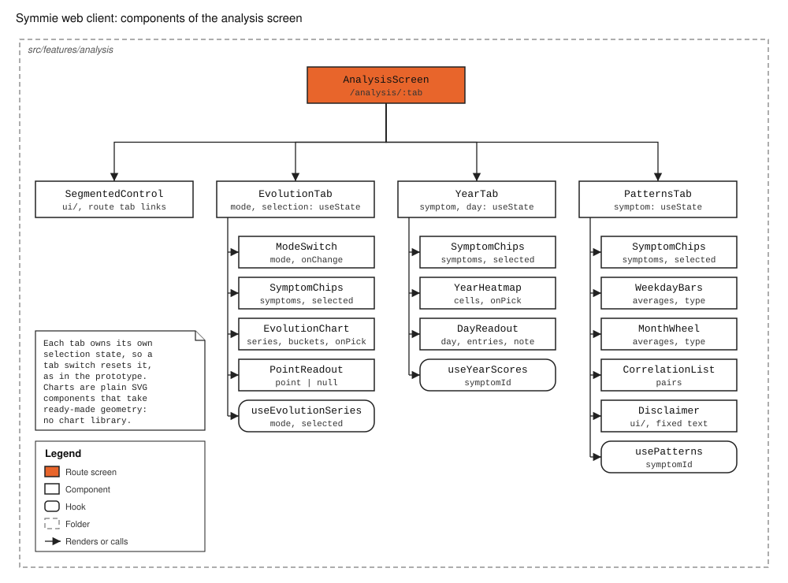
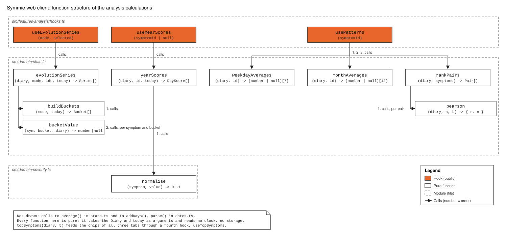
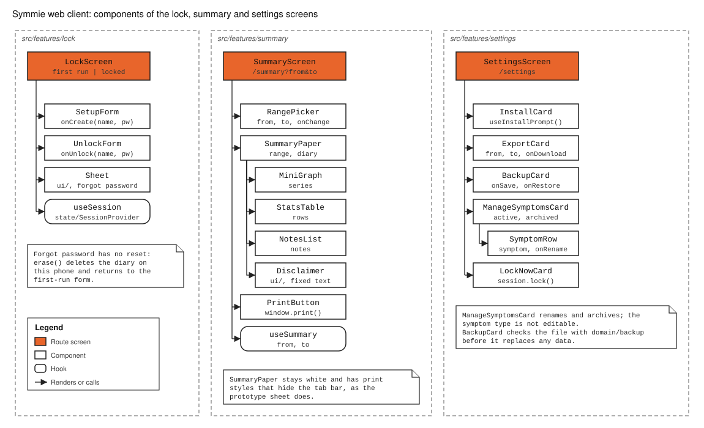
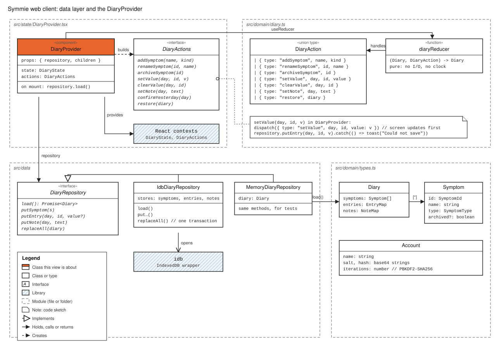
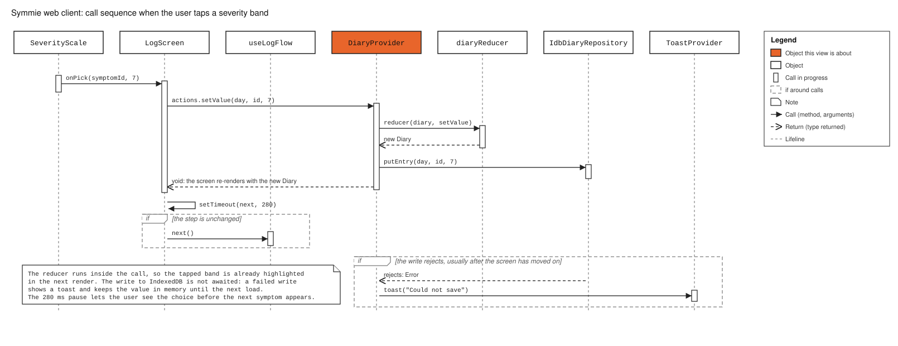

# Symmie web client: code design

This is the plan for turning `prototype-b/` ("Night shift") into a React application. The prototype is
one 390-line file of string templates, a global `ui` object and a global `db` object. Nothing in it is
reused as code; what carries over is the behaviour, the look, and the calculations (which move into pure
functions). The diagrams are in `docs/code-design/frontend/`, drawn in the style of the templates in
`docs/code-design/templates/`.

Status: the design the client in `src/` was built from. Section 1 lists the choices it rests on.

## 1. Assumptions the design rests on

| Choice | Decision | Alternative not taken, and why |
|---|---|---|
| Build and language | Vite, React 19, TypeScript in strict mode | Create React App is unmaintained; plain JavaScript loses the compile-time check on `Diary` and `DiaryAction` that the reducer relies on |
| Persistence | IndexedDB through the `idb` wrapper, behind a `DiaryRepository` interface | `localStorage` (what the prototype uses) is synchronous, limited to about 5 MB, and stores one JSON string, so every value tap would rewrite the whole diary |
| Server state library | None. `useReducer` plus two contexts | TanStack Query and Redux Toolkit solve problems this app does not have: there is no server, no cache invalidation, and one user |
| Hosting | Vercel, served over HTTPS; the app is under `/app/` so the site root can hold a landing page. Vite `base` is `/app/`, the build writes to `dist/app/`, and the manifest `id`, `start_url` and `scope` are `/app/`. `vercel.json` redirects `/app` to `/app/` | Serving the app from `/` (the first design): the landing page would share the app's service worker and install scope. Changed after the first design |
| Routing | `react-router` with `HashRouter` | `BrowserRouter` would work on Vercel, which can rewrite every path to `index.html`, but it also needs the service worker to answer navigations offline with a fallback to `index.html`. `HashRouter` needs neither a host rule nor that fallback, and the installed PWA hides the URL bar, so clean URLs give the user nothing |
| Styling | CSS Modules with design tokens in `tokens.css` (custom properties) | Tailwind is workable but the prototype's look comes from a handful of tokens and per-severity colours passed as `--c`; CSS Modules keep that without a second vocabulary |
| Charts | Hand-written SVG components over a pure `geometry` module | A chart library adds bundle weight to an offline-first PWA and cannot reproduce the prototype's glowing lines, heatmap and wheel without overriding most of it |
| PWA | `vite-plugin-pwa` (Workbox), precache of the build output | Writing the service worker by hand; Workbox already handles versioned precache and update |
| Tests | Vitest, React Testing Library, `@testing-library/user-event` | Jest needs extra transform configuration under Vite |
| Password lock | PBKDF2-SHA256 through Web Crypto with 600,000 iterations (the OWASP figure), random salt, stored with the iteration count. Slice 3 measures unlock time on a low-end Android phone | The prototype's `hash()` (djb2) is marked in its own header as a stand-in. This is still a local lock, not protection against someone who can read the phone's storage (see `README.md`, Assumptions) |

Out of scope: the daily reminder (deferred). The prototype's reminder card and its
"fire reminder" panel button are not carried over.

## 2. Principles

1. **Components render; they do not calculate.** Every figure on screen (a bucket average, a correlation,
   a heatmap colour) is produced by a pure function in `src/domain/` that takes the `Diary` and the date as
   arguments. A component gets finished values as props.
2. **Dependencies point down.** `app` → `features` → `state` / `ui` / `pwa` → `data` → `domain`. `domain`
   imports no React. `ui` imports nothing from `features`. Diagram 01.
3. **State lives at the lowest component that needs it.** Only what several screens share is in a provider.
   Section 4 maps every field of the prototype's `ui` object to its new home.
4. **Persistence is behind an interface.** Components never see IndexedDB. Tests pass
   `memoryRepository`; the app passes `idbRepository`.
5. **Time is an input.** Nothing outside `ClockProvider` calls `new Date()`. Tests set "today" and
   assertions about "Yesterday", the 21-day strip and the last 10 weeks stay stable.
6. **A screen's logic is a hook, its markup is a component.** `useLogFlow`, `useDayLog`, `useEvolutionSeries`
   and the like can be tested without rendering, and components stay short.

## 3. Folder layout

```
src/
  main.tsx
  app/              App, AppRoutes, LockGate, AppShell, TabBar, OfflineBanner, ToastHost
  features/
    lock/           LockScreen, SetupForm, UnlockForm
    log/            LogScreen, DayHeader, DayStrip, StepProgress, SymptomStep, DayRecap, forms, hooks
    analysis/       AnalysisScreen, EvolutionTab, YearTab, PatternsTab, charts, hooks.ts
    summary/        SummaryScreen, RangePicker, SummaryPaper, PrintButton
    settings/       SettingsScreen, InstallCard, ExportCard, BackupCard, ManageSymptomsCard, LockNowCard
  state/            ClockProvider, SessionProvider, DiaryProvider, ToastProvider
  ui/               Button, Card, Sheet, SegmentedControl, Chip, Switch, Field, Disclaimer, tokens.css
  pwa/              useInstallPrompt, useOnlineStatus, service-worker registration
  data/             DiaryRepository, idbRepository, memoryRepository, passwordHasher
  domain/           types, diary, dates, severity, stats, geometry, csv, backup, summary
```

Each feature folder has one public file, its `…Screen` component (and, for analysis, `hooks.ts`).
Other folders import the screen, nothing else in the folder. Tests sit beside the file they test
(`stats.ts`, `stats.test.ts`).

## 4. Where the prototype's state goes

| Prototype field (`ui.*`, `db.*`) | New home | Why there |
|---|---|---|
| `unlocked`, `screen`, `db.user` | `SessionProvider` (`status`: `loading`, `first-run`, `locked`, `unlocked`) | `LockGate` and the settings "Lock now" button both read it |
| `tab` | The route (`/log`, `/analysis/:tab`, `/summary`, `/settings`) | The Android back button and a reload return to the same screen |
| `date` | Route parameter `/log/:date?`; missing means today | "Open this day" from the heatmap becomes a link |
| `idx` (current symptom step) | `useLogFlow` inside `LogScreen` | Only the log screen reads it. Resets when the date changes |
| `sheet`, `nt`, `err` | `useState` in the component that opens the sheet, or in the form | One sheet at a time; the error belongs to its form |
| `sel`, `mode`, `pt` | `EvolutionTab` | Not read elsewhere |
| `hm`, `yd` | `YearTab` | Same |
| `wdSym` | `PatternsTab` | Same |
| `sumFrom`, `sumTo` | Query string `/summary?from=&to=` | A range can be reopened or shared as a link |
| `showArch` | `ManageSymptomsCard` | Same |
| `toast` | `ToastProvider` | Written by the diary actions on a failed save, and by settings |
| `offline` (demo toggle) | `useOnlineStatus` reads `navigator.onLine` | The real app reports the real state; the demo toggle is dropped |
| `db.symptoms`, `db.entries`, `db.notes` | `DiaryProvider` (`Diary`) | Read by every feature; written through `DiaryActions` |
| `db.reminder` | Not carried over | Reminder deferred |

## 5. Diagrams

### 5.1 Module layers (`frontend/01-module-layers.svg`)



Which folder may import which. `DiaryRepository` is the one seam: `state/` knows the interface, and only the
`App` component in `app/` names `idbRepository`. This is what lets a component test run with an
in-memory diary and what would let a server-backed repository replace IndexedDB later, if that
decision is ever made, without touching a component.

### 5.2 App shell and routes (`frontend/02-app-shell-and-routes.svg`)



`App` nests the providers; `LockGate` renders `LockScreen` unless the session is unlocked, and
otherwise renders `AppShell`, whose `Outlet` shows the matched screen. `AppShell` owns the floating tab bar,
the offline banner and the toast host, so no screen draws navigation itself.

### 5.3 Log screen components (`frontend/03-log-components.svg`)



The log screen is the one the user opens daily, so it carries the most structure.

- `SymptomStep` shows one symptom: `SeverityScale` (ten bands) or `YesNoChoice` (two halves), the
  `SameAsYesterday` button, the `ConfirmAllPill` and `StepNav`. It receives the symptom, today's value and
  yesterday's value as props and reports a choice through `onPick`; it does not know the date.
- `DayRecap` is the last step: `SymptomTileGrid` and the day note. `DayNoteField` keeps a draft in
  local state and writes through `setNote` 400 ms after typing stops, so each keystroke does not
  write to IndexedDB.
- `Sheet` (from `ui/`) wraps `AddSymptomForm`, `SymptomMenuForm` and `PickDateForm`. It uses the native
  `<dialog>` element, so focus handling and Escape-to-close come from the browser.
- Severity colour is passed as a CSS custom property (`style={{ '--c': severityColor(value) }}`) computed by
  `domain/severity`, and the stylesheet decides how to use it.

### 5.4 Analysis screen components (`frontend/04-analysis-components.svg`)



`AnalysisScreen` renders a `SegmentedControl` of three route links and the matching tab. Each tab keeps its
own selection state and calls one hook that returns ready-to-draw data. `EvolutionChart`, `YearHeatmap`,
`WeekdayBars` and `MonthWheel` are presentational: they receive points, cells or averages and draw SVG.
The geometry (scales, `linePath`, polar points for the wheel) is in `domain/geometry`, so a test can assert a
path string without rendering.

### 5.5 Analysis calculations (`frontend/08-analysis-functions.svg`)



The prototype computes these inside its view functions. They become pure functions of `(diary, …, today)`:
`evolutionSeries`, `yearScores`, `weekdayAverages`, `monthAverages`, `rankPairs` (which calls `pearson`).
The hooks only memoise them with `useMemo` keyed on the diary and the inputs. The behaviours carried over
from the prototype, each of which needs a test of its own:

- Yes/no symptoms are plotted as the share of days answered yes, times 10, so they share the 0-10 axis.
- A bucket with no entries is `null`, and the line breaks there; it is never drawn as zero.
- `pearson` returns `r: null` when fewer than 14 days have both symptoms logged.
- Week and month buckets average the days inside them; the last 10 of each are shown.

### 5.6 Lock, summary and settings components (`frontend/05-lock-summary-settings-components.svg`)



`SummaryPaper` is a component of its own so that the print stylesheet can target one element, hide the tab bar
and the range controls, and print white-on-white as the prototype does. `BackupCard` checks a restored file
with `domain/backup` (schema version, shape of `symptoms`, `entries`, `notes`) before it calls
`restore(diary)`; a file that fails the check changes nothing. The backup file carries a `version` field,
starting at 1. A backup written by an older version must still restore after any schema change: when the
schema changes, `domain/backup` gains a migration from each earlier version, and a test restores a stored
file of each earlier version.

### 5.7 Data layer and DiaryProvider (`frontend/06-data-layer.svg`)



- `Diary` is `{ symptoms, entries, notes }`. `entries` maps a day key (`YYYY-MM-DD`, in the phone's local
  time) to a map of symptom id to value. A `Symptom` has a fixed `type` (`strength` or `yesno`) and an optional
  `archived` flag.
- `diaryReducer(diary, action)` is pure and covers every change: add, rename, archive, set or clear a value,
  set a note, restore a backup. `DiaryProvider` runs it with `useReducer`.
- `DiaryProvider` provides two contexts. The state context changes on every edit; the actions context is
  created once (`useMemo`) and never changes, so components that only write (`SymptomStep`) do not re-render on
  each edit.
- `IdbDiaryRepository` stores one record per symptom, one per day (`{ day, values }`) and one per note, so a
  value tap writes one small record. `replaceAll` runs in a single transaction so a failed restore leaves
  the old diary intact. The database is opened with version 1; later schema changes are steps in the
  `upgrade` callback of `idb`'s `openDB`, each guarded by the old version number, so existing data is
  migrated and not recreated.
- `DiaryProvider` loads the diary once on mount and keeps it in memory; at a year or two of daily entries
  this is a few thousand small values.

### 5.8 Logging a value: call sequence (`frontend/07-log-sequence.svg`)



The decision shown here: the screen updates before the write finishes. `setValue` dispatches to the reducer
(synchronous), starts `repository.putEntry` without awaiting it, and returns. If the write rejects,
`DiaryProvider` shows a toast through `ToastProvider` and keeps the value in memory. The alternative, awaiting
the write before updating, adds a visible delay to the interaction the product is built around (logging in
seconds while tired) for a failure that is rare on a phone.

## 6. Testing plan

| Layer | What is tested | How |
|---|---|---|
| `domain/*` | Every pure function: buckets, averages, `pearson` with fewer than 14 pairs, `diaryReducer` for each action, `csv` quoting, `backup` validation | Vitest, no DOM. Tables of inputs and expected outputs |
| `data/idbRepository` | Round trip of each method, `replaceAll` rollback | Vitest with `fake-indexeddb` |
| `state/*` | `DiaryProvider` loads, applies actions and shows a toast when `putEntry` rejects | Testing Library with a `memoryRepository` whose methods can be made to reject |
| Features | Each acceptance criterion as an assertion on rendered output: tapping a band saves it and shows the next symptom; "Same as yesterday" copies the value; "Same as yesterday for all N" appears only when N > 1; an archived symptom is absent from the log and present in the summary | Testing Library and `user-event`, `ClockProvider` fixed to a known date |
| `pwa/` | Install prompt and online state hooks | Hook tests with a stubbed `beforeinstallprompt` event and `navigator.onLine` |

Each test is run against a deliberately broken change to the code it constrains (mutation check) before the
change is merged. Not covered by component tests: installing the PWA
and working offline need a browser against a built app, which is checked by hand.

## 7. Cross-cutting rules

- **Accessibility.** Every tappable thing is a `<button>` or `<a>`, never a clickable `<div>`. Severity bands
  and the yes/no halves set `aria-pressed`. Colour is never the only carrier of meaning: each band shows its
  number, each tile its value. Charts have a text alternative (the readout under them, and a `<table>` of the
  values inside a visually hidden element).
- **Dates.** Day keys are local-date strings. `addDays` uses `Date#setDate`, which respects daylight-saving
  changes, as the prototype's does; `domain/dates` is the only module that constructs `Date` objects.
- **Escaping.** Symptom names and notes are rendered as React text, which escapes them. `dangerouslySetInnerHTML`
  is not used anywhere; the prototype's `esc()` has no counterpart.
- **Storage eviction.** The app asks the browser for persistent storage (`navigator.storage.persist()`) after
  the first symptom is added, and the backup card shows the date of the last backup, because clearing site data
  deletes the diary.
- **Layout.** Mobile first; the prototype's phone frame and side panel are not built.
- **Updates.** The service worker precaches the build. A new version is installed in the background and
  applies on the next launch, never while the user is mid-entry.
- **Location.** The service worker is `/app/sw.js` with scope `/app/`, and `navigateFallback: 'index.html'`
  resolves against it to `/app/index.html`. Icon URLs in the manifest are written as `/app/icon-*.png`
  (Vite does not rewrite manifest values). `vite build` empties `dist/app/` only, so a landing page copied
  into `dist/` beside it is not deleted. `/app` without the slash is redirected by `vercel.json`, because the
  scope needs it.

## 8. Build order

Each slice is one pull request, with tests first.

1. **Scaffold.** Vite, TypeScript, ESLint, Vitest, `tokens.css`, the `ui/` primitives, and the npm scripts:
   install `npm ci`; test `vitest run`, with `jsdom` as the test
   environment; typecheck `tsc --noEmit` (or `tsc -b`); lint `eslint .`; build `vite build`. The typecheck is its
   own command because `vite build` does not type-check.
2. **Domain and data.** `types`, `dates`, `diaryReducer`, `memoryRepository`, `idbRepository` (database version 1 in
   the `upgrade` callback), the backup file's `version` field.
3. **Lock.** `passwordHasher`, `SessionProvider`, `LockGate`, `LockScreen`. Unlock time is measured on a low-end
   Android phone with the 600,000 iterations.
4. **Log.** `DiaryProvider`, `LogScreen` and children, symptom forms.
5. **Settings.** Manage symptoms, CSV export, backup and restore.
6. **Analysis, evolution tab.** `stats`, `geometry`, `EvolutionChart`.
7. **Analysis, year and patterns tabs.**
8. **Summary.** Range, paper, print stylesheet.
9. **PWA.** Manifest, service worker, install card, offline check in a browser.

Slices 3 to 5 each leave the app usable; 6 to 8 add screens without changing earlier ones.

## 9. Open points

- **The step index is not in the URL.** On Android, Back from step 3 of the log leaves the log screen instead
  of going to step 2. Putting the step in the query string (`/log/2026-11-10?step=2`) fixes that and costs a
  history entry per tap, which the user would have to press Back through. **Decided 2026-11-11: the
  step stays in component state, not in the URL, for the first version.** Reopen it if user feedback shows
  people losing their place with Back.
- **Diary data is not encrypted.** The lock only hides the screen. Encrypting the stores with a key derived
  from the password would also make a forgotten password unrecoverable even with a backup file, so it is not
  planned.
- **Temperature for "season".** Not used in this version, as in the prototype (README, Assumptions).
